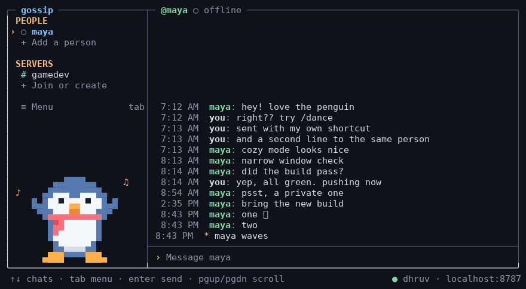

# gossip

End-to-end encrypted chat that lives inside your terminal. Direct messages,
group servers, contacts — and Pebble, a penguin who dances while you connect.



- **A real chat screen, no commands needed.** Your chats on the left, the conversation on the right. Arrow keys, a menu (Tab) and the mouse do everything.
- **Files and photos, right in the terminal.** Drag a picture into the window and it shows up as a picture for both of you.
- **Private by design.** Messages are encrypted on your computer; whatever passes them along can't read them.
- **Works without internet too.** `gossip nearby` finds people on the same Wi-Fi or cable.
- **Commands if you like them.** `gossip check`, `gossip squawk maya hi`, `gossip listen` work from any terminal.
- **Yours to shape.** Six themes, your own colours, two looks, shortcuts — it's all in the menu.
- **Looks after itself.** It updates on its own. No accounts, emails or passwords. Zero dependencies.

## Install

**macOS and Linux**

```sh
curl -fsSL https://raw.githubusercontent.com/dpatel7-dev/gossip/main/install.sh | sh
```

**Windows** (PowerShell)

```powershell
irm https://raw.githubusercontent.com/dpatel7-dev/gossip/main/install.ps1 | iex
```

Then open a new terminal window and type `gossip`.

If a friend gave you a link to their gossip website, use the install line shown
there instead: it's the same installer, and it already knows where to connect.

The installer needs no admin rights and keeps everything inside your home
folder. If you don't have Node.js 18+, it downloads a private copy just for
gossip.

## First run

`gossip` asks one thing the first time: **pick a username.** That's how people find you.

If you didn't install from a gossip website, it first asks **where your friends
chat**: the address of a gossip website or relay someone gave you (see
[Where messages go](#where-messages-go)). No internet at all? Skip that and run
`gossip nearby`.

Your encryption keys are created on your computer at that moment. There is no
password: the file `~/.gossip/identity.json` *is* your account, so back it up.

## The chat screen

Type `gossip`.

```
╭─ gossip ───────────────┬─ maya ● online ─────────────────────────────╮
│ PEOPLE                 │                                             │
│› ● maya                │  2:23 PM  maya: are you coming?             │
│  ○ sam              2  │  2:24 PM  you: yes, 10 min                  │
│  + Add a person        │  2:24 PM  maya: ok!                         │
│                        │                                             │
│ SERVERS                │                                             │
│  # gamedev             ├─────────────────────────────────────────────┤
│  + Join or create      │ › Message maya                              │
╰────────────────────────┴─────────────────────────────────────────────╯
 ↑↓ chats · tab menu · enter send                    ● dhruv · online
```

| Key | What it does |
| --- | --- |
| `↑` `↓` | Move between your chats (whatever you'd half typed waits in its own chat) |
| `Tab` | Open the menu: add people, join or create servers, invite, remove, block, colours, every setting |
| `Enter` | Send |
| `/` `@` `#` | Start typing a command, a person or a server and suggestions pop up: `↑` `↓` to choose, `Tab` to complete, `Esc` to hide |
| `Ctrl+N` | Jump to the next chat with unread messages |
| `PgUp` `PgDn` | Scroll back through the conversation (it tells you when new messages arrive below) |
| Mouse | Click a chat; scroll with the wheel (hold Shift to select text) |
| `Ctrl+D` | Leave |

Prefer messages as ordinary scrolling lines you can select and copy? That's the
**classic look**: choose *Make it yours → Switch to the classic look* in the
menu, or run `gossip --classic`. It has the same menu on `Tab`. Your choice is
remembered (`gossip config view full` / `classic`).

## Commands, if you like them

### 1. From your shell

```sh
gossip check                      # what arrived while you were away
gossip squawk maya hey there      # send a message to a person...
gossip squawk gamedev hello all   # ...or to a server (names work bare)
gossip listen                     # stay tuned: print messages as they arrive
gossip listen maya                # ...only from one person or server
gossip recap maya 30              # replay the last 30 messages with maya
echo "build passed" | gossip squawk gamedev    # pipe anything in
```

You can keep `gossip listen` running in one tab and use the other commands in
another — one account works in as many terminals as you like.

### 2. Inside the chat

Type `gossip` on its own:

```
@maya hey there          message a person (and keep talking to them)
#gamedev hello           message a server
just type                goes to whoever is shown in the prompt
/help                    every command
```

`Tab` completes names and commands (on an empty line it switches who you're
talking to), `Up`/`Down` recall what you typed, `Alt+Enter` adds a new line,
`Ctrl+D` leaves. Every shell command works here with a `/` in front:
`/squawk`, `/add`, `/join` …

## People

```sh
gossip add maya          # save a contact
gossip contacts          # who's online (you see each other once you've both added each other)
gossip remove maya
gossip block maya        # stop their messages; they aren't told
```

## Servers (group chats)

A server is a group chat with an owner — whoever created it.

```sh
gossip servers                   # browse public servers
gossip create gamedev            # start one; you own it
gossip create club private       # invite-only
gossip join gamedev
gossip invite maya gamedev
gossip who gamedev               # members, with the owner marked ★
gossip kick sam gamedev          # owner only: remove someone
gossip leave gamedev
```

Someone who has been kicked can't rejoin unless the owner invites them back,
and can't read anything sent after they were removed. If the owner leaves, the
longest-standing member becomes the owner.

## Make it yours

```sh
gossip config                    # every setting, and what it's set to
gossip config theme ember        # change one
gossip config reset theme        # put one back (or: reset all)
gossip theme                     # preview all colour schemes
```

| Setting | Choices | What it does |
| --- | --- | --- |
| `theme` | `arctic` `ember` `aurora` `daylight` `terminal` `mono` | Colour scheme (`daylight` turns gossip light, even in a dark terminal) |
| `background` | `auto` `theme` `terminal` | Paint gossip's own background: `auto` = only daylight does, `theme` = every theme, `terminal` = never |
| `mascot` | `random` `dance` `phone` `laptop` `off` | What the penguin is doing when gossip opens |
| `mascot.animate` | `on` `off` | Let the penguin move, or show a still picture |
| `mascot.speed` | `slow` `normal` `fast` | How quickly it moves |
| `welcome` | `full` `compact` `off` | How much to show when gossip opens |
| `prompt.style` | `box` `rules` `bare` | The frame around where you type |
| `prompt.symbol` | up to 3 characters | The mark in front of what you type |
| `footer` | `on` `off` | The status line under the prompt |
| `layout` | `compact` `cozy` | One line per message, or the name above the text |
| `time` | `12h` `24h` `off` | Clock on each message |
| `names` | `colored` `plain` | Give each person their own colour |
| `you` | up to 20 characters | How your own messages are labelled |
| `links` | `underline` `plain` | How web links are shown |
| `bell` | `all` `mentions` `off` | Sound for DMs and @mentions |
| `typing` | `on` `off` | Show (and send) "is typing…" |
| `receipts` | `on` `off` | Tell you when a DM is delivered |
| `presence` | `on` `off` | Tell you when a contact comes online |
| `recap` | `0`–`50` | Messages to replay when you switch chats |

Two more families take any name:

```sh
gossip config color.accent "#ff8800"     # recolour one part of the theme
gossip config alias.m "squawk maya"      # your own shortcut:  gossip m running late!
```

Colour parts: `accent` `accent2` `border` `dim` `ok` `warn` `err` `server`
`link` and `name1`…`name8`. The `terminal` theme uses only your terminal's own
16 colours; `mono` uses none.

Want to watch Pebble? `gossip dance`, `gossip dance phone`, `gossip dance laptop`.

## More things it can do

```sh
(drag a file in, press Enter)  # (inside a chat) send a file or photo; photos show up as pictures
/file ~/Desktop/photo.png   # (inside a chat) the same, typed
/files   /open             # (inside a chat) list the files in a chat, open the newest
/call maya                  # (inside a chat) voice call, in your browser; /video maya for video
/answer  /decline  /hangup  # (inside a chat) or just Enter / Esc while it rings
                            # in a call: t chat, 1-5 reactions, d pick mic/camera/speaker, p pop out, f fullscreen
/dashboard                  # (inside a chat) every connection, who can read what, activity -
                            # plus read and reply to any chat, search your messages,
                            # check safety numbers, call, and change settings from the page
/remind 10m stretch         # (inside a chat) a reminder; /remind 5pm call mom, /remind lists them
/later 8am happy birthday!  # (inside a chat) send to this chat later; /later lists them
/dnd 1h                     # (inside a chat) do not disturb: no sounds or pop-ups (/dnd off)
/update  then  /restart     # (inside a chat) get the newest version without leaving
gossip mini                 # a tiny chat for the corner of your screen, with quick replies
gossip rename newname       # change your username; chats, servers and contacts come along
gossip security             # is anything wrong? (connection, changed keys, other sign-ins)
gossip signout              # close your account in every other window
/me waves                   # (inside a chat) an action: * dhruv waves
:fire: :thumbsup: :party:   # (inside a chat) typed words become emoji
gossip config notify off    # stop desktop pop-ups (or: preview, on)
gossip mute maya            # no sound or unread count for a chat (same command to undo)
gossip find pizza           # search your saved messages
gossip export maya          # save a chat to a text file
gossip give maya gamedev    # hand a server you own to another member
gossip kick sam gamedev     # owner only; works even if sam is offline or hasn't joined yet
gossip changelog            # what's new in each version
gossip uninstall            # remove gossip (asks first; can keep your account)
```

All of these are in the Tab menu too. Your People list only ever holds people
you added yourself; a message from anyone else shows under "Others" until you've read it.

## No internet? `gossip nearby`

```sh
gossip nearby
```

It looks for other people running `gossip nearby` on the same local network —
the same Wi-Fi router (it doesn't have to be online), a hotspot, or a network
cable between two computers. The first person in quietly hosts; everyone else
finds them, and you all land in a server called `#nearby`. If the host leaves,
someone else takes over.

- Messages are end-to-end encrypted exactly as they are over the internet.
- If your computer asks whether to let Node.js use the network, say yes.
- If it can't find the others (some school and café networks block this), the host's screen shows a line like `gossip nearby 192.168.1.5` for them to type.
- Computers with no connection between them at all can't chat. There has to be *some* link.

## Updates

gossip checks for a new version in the background every few hours, downloads
it, checks that it starts, and switches over the next time you run `gossip`. It
never changes anything underneath a running chat.

```sh
gossip update                  # check and fetch right now
gossip config update notify    # just tell me, don't download
gossip config update off       # never check
```

(For whoever maintains the project: a "new version" is a higher `version` in
`package.json` on GitHub.)

## How private is it?

gossip uses standard, published cryptography that ships inside Node.js:

| | |
| --- | --- |
| Who you are | an Ed25519 key, made on your computer |
| Encrypting to someone | X25519 key agreement |
| Each message | ChaCha20-Poly1305 with a fresh random key, signed by the sender |

**The relay never sees your messages** — only locked boxes and who they're
for. It stores usernames with their *public* keys, server member lists, and
undelivered ciphertext, which is deleted as soon as it's delivered. In servers,
each message is locked separately for every current member.

Be clear-eyed about the limits:

- **The relay sees metadata**: who talks to whom, and when.
- **No forward secrecy**: if someone steals your key file *and* has recorded your past traffic, they can read it.
- **First contact is trust-on-first-use**: gossip remembers each person's key and warns loudly if it ever changes. To be certain nobody is in the middle, compare numbers once: `gossip verify maya`.
- **A public server is public**: anyone can join and read from then on.
- **History is saved unencrypted** on your own disk, in `~/.gossip/history`.

It has not had a professional security audit. Treat it as a private chat for
friends, not as a tool for life-or-death secrets.

## Where messages go

Two computers at home can't reach each other directly, so something on the
internet has to pass the (sealed) messages along. There are two choices, and
both work with the same app:

**A gossip website — the easy one.** The install page can do it. Put it on
PythonAnywhere's free plan once (five minutes, no server to look after) and
everyone who installs from it is connected automatically:
[step-by-step guide](docs/HOSTING.md).

**A relay — if you have a machine that's always on.** Faster (messages are
instant instead of arriving within a second or two) and entirely yours.

```sh
gossip relay https://yourname.pythonanywhere.com   # use a website
gossip relay wss://chat.example.com                # use a relay
gossip relay                                       # show what you're using
```

## Calls on strict networks

Calls connect your computers directly. Where a network blocks that, a call relay
(TURN) passes the (still end-to-end encrypted) call along. The easy way needs no
server: get a free relay login from ExpressTURN and paste it into your website's
`config.json`. Or run gossip's own relay (`gossip turn`) on an always-on machine.
[Step-by-step](docs/HOSTING.md#make-calls-work-on-strict-networks-optional-recommended).
With it, `gossip config call.hideip on` keeps your IP address hidden from people you call.

## Run your own relay

It's one command:

```sh
gossip serve
```

It prints the port it's listening on (8787). Friends then connect with
`gossip --relay ws://YOUR-ADDRESS:8787`.

### Keep it running 24/7 (a Linux server, e.g. a small Google Cloud VM)

```sh
# 1. on the server: install gossip
curl -fsSL https://raw.githubusercontent.com/dpatel7-dev/gossip/main/install.sh | sh

# 2. register it as a service that starts on boot
sh ~/.gossip/app/deploy/setup-relay.sh

# 3. open the port (Google Cloud; or do it in the console under VPC network > Firewall)
gcloud compute firewall-rules create gossip-relay --allow tcp:8787
```

### Options

```sh
gossip serve --port 9000 --name "Dhruv's relay" --motd "be nice"
gossip serve --no-signups        # existing accounts only
gossip serve --max-members 50    # cap the size of servers
gossip serve --help
```

### Add TLS (recommended)

Without TLS, message *text* is still end-to-end encrypted, but usernames and
who-talks-to-whom are visible to anyone watching the network. If you have a
domain name, [`deploy/Caddyfile`](deploy/Caddyfile) puts the relay behind
[Caddy](https://caddyserver.com), which fetches a certificate for you. People
then connect with just `gossip --relay chat.example.com`.

### Make your relay (or website) the default

Edit `gossip.config.json` in this repo and push:

```json
{
  "repo": "dpatel7-dev/gossip",
  "branch": "main",
  "hub": "wss://chat.example.com"
}
```

Anyone who installs after that skips the "where do your friends chat?" question.

## Good to know

| | |
| --- | --- |
| Update | Automatic. `gossip update` does it now; `gossip config update off` stops it |
| Your account | `~/.gossip/identity.json` (back it up; copy it to move to another computer) |
| Settings, contacts, history | `~/.gossip/` |
| Relay data | `~/.gossip-server/` on the machine running `gossip serve` |
| Uninstall (old way) | `rm -rf ~/.gossip ~/.local/bin/gossip` (Windows: delete `%USERPROFILE%\.gossip`) |
| No colours | set `NO_COLOR=1`, or `gossip config theme mono` |

## For developers

```sh
git clone https://github.com/dpatel7-dev/gossip && cd gossip
npm test                     # crypto, relay, website, client, nearby, updater, real CLI runs
node bin/gossip.js serve     # a local relay
GOSSIP_HOME=/tmp/alice node bin/gossip.js --relay localhost:8787
GOSSIP_HOME=/tmp/bob   node bin/gossip.js --relay localhost:8787
python3 hub/gossip_hub.py --port 8080    # the website + hub, locally
node tools/build-site.js     # rebuild site/index.html after editing index.src.html
```

```
bin/gossip.js      entry point
src/cli.js         shell commands, first-run setup
src/screen.js      the full chat screen
src/shitty.js      the classic look
src/menu.js        the menu both looks share
src/commands.js    every command (shared by the shell, the chat and the menu)
src/app.js         client core: keys, sending, receiving
src/e2e.js         the encryption
src/render.js      how things look        src/theme.js   colour schemes
src/mascot.js      Pebble's pixel art     src/prefs.js   settings
src/net.js, ws.js  connection to a relay (a small built-in WebSocket) or a website
src/nearby.js      finding people on the local network
src/update.js      self-updating
server/relay.js    the relay
hub/gossip_hub.py  the website: install page + message passing (plain Python)
site/              the install page          docs/HOSTING.md   putting it online
```

No dependencies: everything is Node.js built-ins.

## License

MIT
