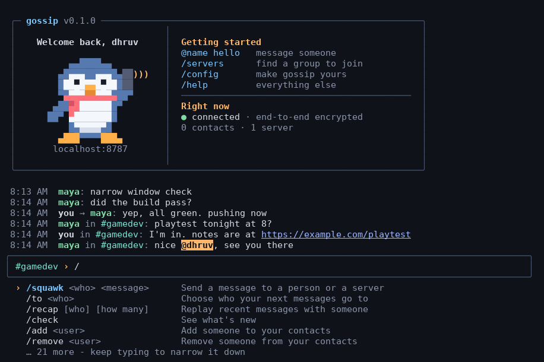

# gossip

End-to-end encrypted chat that lives inside your terminal. Direct messages,
group servers, contacts — and Pebble, a penguin who dances while you connect.



- **Runs in your normal terminal.** No full-screen takeover: messages are ordinary lines you can scroll, select and copy.
- **Private by design.** Messages are encrypted on your computer; the relay that passes them along can't read them.
- **Two ways to use it.** Quick shell commands (`gossip check`, `gossip squawk maya hi`) or a live chat prompt (`gossip`).
- **Yours to shape.** Six themes, your own colours, layouts, shortcuts — `gossip config` shows every knob.
- **Nothing to install but gossip.** No accounts, emails or passwords. Zero dependencies.

## Install

**macOS and Linux**

```sh
curl -fsSL https://raw.githubusercontent.com/dpatel7-dev/gossip/main/install.sh | sh
```

**Windows** (PowerShell)

```powershell
irm https://raw.githubusercontent.com/dpatel7-dev/gossip/main/install.ps1 | iex
```

Then open a new terminal window and type `gossip`.

The installer needs no admin rights and keeps everything inside your home
folder. If you don't have Node.js 18+, it downloads a private copy just for
gossip.

## First run

`gossip` asks two things the first time:

1. **Which relay?** The address of the gossip relay you and your friends use (see [Run your own relay](#run-your-own-relay)).
2. **Pick a username.** That's how people find you.

Your encryption keys are created on your computer at that moment. There is no
password: the file `~/.gossip/identity.json` *is* your account, so back it up.

## Two ways to chat

### 1. From your shell

```sh
gossip check                      # what arrived while you were away
gossip squawk maya hey there      # send a message to a person...
gossip squawk gamedev hello all   # ...or to a server (names work bare)
gossip listen                     # stay tuned: print messages as they arrive
gossip listen maya                # ...only from one person or server
gossip recap maya 30              # replay the last 30 messages with maya
echo "build passed" | gossip squawk gamedev    # pipe anything in
```

You can keep `gossip listen` running in one tab and use the other commands in
another — one account works in as many terminals as you like.

### 2. The live prompt

Type `gossip` on its own:

```
@maya hey there          message a person (and keep talking to them)
#gamedev hello           message a server
just type                goes to whoever is shown in the prompt
/help                    every command
```

`Tab` completes names and commands (on an empty line it switches who you're
talking to), `Up`/`Down` recall what you typed, `Alt+Enter` adds a new line,
`Ctrl+D` leaves. Every shell command works here with a `/` in front:
`/squawk`, `/add`, `/join` …

## People

```sh
gossip add maya          # save a contact
gossip contacts          # who's online (you see each other once you've both added each other)
gossip remove maya
gossip block maya        # stop their messages; they aren't told
```

## Servers (group chats)

A server is a group chat with an owner — whoever created it.

```sh
gossip servers                   # browse public servers
gossip create gamedev            # start one; you own it
gossip create club private       # invite-only
gossip join gamedev
gossip invite maya gamedev
gossip who gamedev               # members, with the owner marked ★
gossip kick sam gamedev          # owner only: remove someone
gossip leave gamedev
```

Someone who has been kicked can't rejoin unless the owner invites them back,
and can't read anything sent after they were removed. If the owner leaves, the
longest-standing member becomes the owner.

## Make it yours

```sh
gossip config                    # every setting, and what it's set to
gossip config theme ember        # change one
gossip config reset theme        # put one back (or: reset all)
gossip theme                     # preview all colour schemes
```

| Setting | Choices | What it does |
| --- | --- | --- |
| `theme` | `arctic` `ember` `aurora` `daylight` `terminal` `mono` | Colour scheme |
| `mascot` | `random` `dance` `phone` `laptop` `off` | What the penguin is doing when gossip opens |
| `mascot.animate` | `on` `off` | Let the penguin move, or show a still picture |
| `mascot.speed` | `slow` `normal` `fast` | How quickly it moves |
| `welcome` | `full` `compact` `off` | How much to show when gossip opens |
| `prompt.style` | `box` `rules` `bare` | The frame around where you type |
| `prompt.symbol` | up to 3 characters | The mark in front of what you type |
| `footer` | `on` `off` | The status line under the prompt |
| `layout` | `compact` `cozy` | One line per message, or the name above the text |
| `time` | `12h` `24h` `off` | Clock on each message |
| `names` | `colored` `plain` | Give each person their own colour |
| `you` | up to 20 characters | How your own messages are labelled |
| `links` | `underline` `plain` | How web links are shown |
| `bell` | `all` `mentions` `off` | Sound for DMs and @mentions |
| `typing` | `on` `off` | Show (and send) "is typing…" |
| `receipts` | `on` `off` | Tell you when a DM is delivered |
| `presence` | `on` `off` | Tell you when a contact comes online |
| `recap` | `0`–`50` | Messages to replay when you switch chats |

Two more families take any name:

```sh
gossip config color.accent "#ff8800"     # recolour one part of the theme
gossip config alias.m "squawk maya"      # your own shortcut:  gossip m running late!
```

Colour parts: `accent` `accent2` `border` `dim` `ok` `warn` `err` `server`
`link` and `name1`…`name8`. The `terminal` theme uses only your terminal's own
16 colours; `mono` uses none.

Want to watch Pebble? `gossip dance`, `gossip dance phone`, `gossip dance laptop`.

## How private is it?

gossip uses standard, published cryptography that ships inside Node.js:

| | |
| --- | --- |
| Who you are | an Ed25519 key, made on your computer |
| Encrypting to someone | X25519 key agreement |
| Each message | ChaCha20-Poly1305 with a fresh random key, signed by the sender |

**The relay never sees your messages** — only locked boxes and who they're
for. It stores usernames with their *public* keys, server member lists, and
undelivered ciphertext, which is deleted as soon as it's delivered. In servers,
each message is locked separately for every current member.

Be clear-eyed about the limits:

- **The relay sees metadata**: who talks to whom, and when.
- **No forward secrecy**: if someone steals your key file *and* has recorded your past traffic, they can read it.
- **First contact is trust-on-first-use**: gossip remembers each person's key and warns loudly if it ever changes. To be certain nobody is in the middle, compare numbers once: `gossip verify maya`.
- **A public server is public**: anyone can join and read from then on.
- **History is saved unencrypted** on your own disk, in `~/.gossip/history`.

It has not had a professional security audit. Treat it as a private chat for
friends, not as a tool for life-or-death secrets.

## Run your own relay

Someone has to run the relay everyone connects to. It's one command:

```sh
gossip serve
```

It prints the port it's listening on (8787). Friends then connect with
`gossip --relay ws://YOUR-ADDRESS:8787`.

### Keep it running 24/7 (a Linux server, e.g. a small Google Cloud VM)

```sh
# 1. on the server: install gossip
curl -fsSL https://raw.githubusercontent.com/dpatel7-dev/gossip/main/install.sh | sh

# 2. register it as a service that starts on boot
sh ~/.gossip/app/deploy/setup-relay.sh

# 3. open the port (Google Cloud; or do it in the console under VPC network > Firewall)
gcloud compute firewall-rules create gossip-relay --allow tcp:8787
```

### Options

```sh
gossip serve --port 9000 --name "Dhruv's relay" --motd "be nice"
gossip serve --no-signups        # existing accounts only
gossip serve --max-members 50    # cap the size of servers
gossip serve --help
```

### Add TLS (recommended)

Without TLS, message *text* is still end-to-end encrypted, but usernames and
who-talks-to-whom are visible to anyone watching the network. If you have a
domain name, [`deploy/Caddyfile`](deploy/Caddyfile) puts the relay behind
[Caddy](https://caddyserver.com), which fetches a certificate for you. People
then connect with just `gossip --relay chat.example.com`.

### Make your relay the default

Edit `gossip.config.json` in this repo and push:

```json
{
  "repo": "dpatel7-dev/gossip",
  "branch": "main",
  "defaultServer": "wss://chat.example.com"
}
```

Anyone who installs after that skips the "Which relay?" question.

## Good to know

| | |
| --- | --- |
| Update | `gossip update` |
| Your account | `~/.gossip/identity.json` (back it up; copy it to move to another computer) |
| Settings, contacts, history | `~/.gossip/` |
| Relay data | `~/.gossip-server/` on the machine running `gossip serve` |
| Uninstall | `rm -rf ~/.gossip ~/.local/bin/gossip` (Windows: delete `%USERPROFILE%\.gossip`) |
| No colours | set `NO_COLOR=1`, or `gossip config theme mono` |

## For developers

```sh
git clone https://github.com/dpatel7-dev/gossip && cd gossip
npm test                     # 39 tests: crypto, relay, client, real CLI runs
node bin/gossip.js serve     # a local relay
GOSSIP_HOME=/tmp/alice node bin/gossip.js --relay localhost:8787
GOSSIP_HOME=/tmp/bob   node bin/gossip.js --relay localhost:8787
```

```
bin/gossip.js      entry point
src/cli.js         shell commands, first-run setup
src/shitty.js      the live prompt
src/commands.js    every command (shared by shell and prompt)
src/app.js         client core: keys, sending, receiving
src/e2e.js         the encryption
src/render.js      how things look        src/theme.js   colour schemes
src/mascot.js      Pebble's pixel art     src/prefs.js   settings
src/net.js, ws.js  connection to the relay (a small built-in WebSocket)
server/relay.js    the relay
```

No dependencies: everything is Node.js built-ins.

## License

MIT
